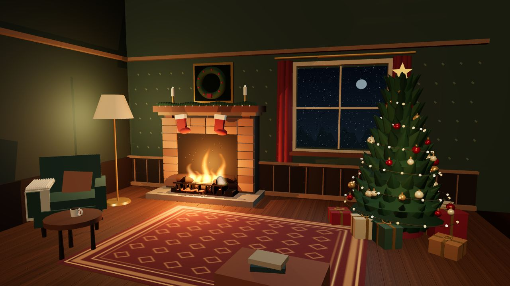

# Emberhush

A little warmth for winter. Emberhush is a small, working Three.js Christmas ambience experience: a living fireplace, a furnished room, a decorated evergreen, and snow falling beyond the window. It is designed to fill a screen and quietly keep you company.



Created for [GameHavn](https://gamehavn.com) and the community idea [Help Build GameHavn’s Instant Page](https://gamehavn.com/ideas/help-build-gamehavn-s-instant-page). The original idea ID remains `ab0325ac-8d12-4c9e-82b2-92dba256ff6c`.

[Open Emberhush](https://ghavn.github.io/emberhush/) · [Source repository](https://github.com/ghavn/emberhush) · [Jochen Labs on GameHavn](https://gamehavn.com/jochen)

[GameHavn prototype](https://gamehavn.com/games/emberhush) · [Original community idea](https://gamehavn.com/ideas/help-build-gamehavn-s-instant-page) · [Stored GameHavn preview](https://gamehavn.com/api/game-images/3dcc1343-92b9-4fe9-869f-7094c16837cf.webp)

Published as a **Prototype** on **Jochen Labs**, category **Simulation**. Both source and playable links are saved on the original idea association. The preview is stored and optimized by GameHavn; the game itself runs on GitHub Pages.

## What works

- **Fire:** choose Close, Medium or Full fireplace for soft, rolling flames, split logs with glowing fissures, coals and fading embers.
- **Room:** a wider view with an armchair, knitted throw, cocoa, patterned rug, stockings, presents, wreath, tree lights, individually modelled needles, rounded ornaments and a snowy moonlit window. The fire casts shifting light across the hearth, rug and furniture.
- Smooth camera transitions between the two modes; portrait and landscape camera compositions.
- Independent **Fire sound** and **Music** buttons. Sound begins only after your click. Music is a quiet, synthesized Jingle Bells refrain, without vocals or an external recording.
- Fullscreen entry and exit in supporting browsers.
- Controls hide after **two seconds**. Click or tap the scene, move the mouse, or press Escape to reveal them again. Selecting a view starts a fresh two-second timeout. Tab reveals the keyboard controls and keeps them available while navigating.
- No accounts, scoring, ads, payments, analytics, network assets or saved settings in the experience.

This is an ambient creative toy, not a challenge game. Its loop is simply to choose a view, optionally enable either sound, enter fullscreen and relax. There are no win/lose conditions or player movement/collision. Reload the page to reset to Room with both sounds off; there is intentionally no game-over or restart screen.

## Controls

| Input | Result |
| --- | --- |
| Fire / `1` | Close hearth view |
| Room / `2` | Christmas room view |
| Close / Medium / Full fireplace | Change framing within Fire |
| Fire sound / `C` | Toggle synthesized crackling |
| Music / `M` | Toggle quiet Jingle Bells |
| Fullscreen / `F` | Enter or exit fullscreen |
| Click/tap the scene, mouse movement, Escape | Reveal controls for two seconds |
| Tab / Shift+Tab / Enter | Navigate and activate controls |
| Browser reload | Reset view, audio and animation |

The `?` button briefly shows viewing tips. Each audio button exposes its on/off state and an accessible name. Fullscreen requires a user gesture and host permission; iOS/browser restrictions may require the browser's own fullscreen options. Hidden controls are inert, so a tap on the scene reveals them without accidentally activating a hidden button.

## Build and run

Tested with **Node.js 22.22.1** and **npm 9.2.0** on Linux. Vite requires Node 20.19+ or 22.12+; a current browser with WebGL 2 and Web Audio is required. Hardware acceleration is recommended. Dependencies are pinned and `package-lock.json` is committed.

Run these from the `emberhush` project directory:

```sh
npm ci
npm run dev
```

Open the Vite URL ending in `/emberhush/`, normally `http://localhost:5173/emberhush/`.

```sh
npm run build
npm run preview -- --port 4173
```

The build first runs strict TypeScript checking and then produces `dist/`. Preview serves the production output at `http://localhost:4173/emberhush/`. No environment variables, API keys or backend are needed.

## Source map

```text
index.html                     Semantic controls, loading and error states
src/main.ts                    Renderer, camera, modes, input, fullscreen and lifecycle
src/room.ts                    Room geometry, generated textures, lighting and particles
src/details.ts                 Instanced evergreen, cloth folds and surface textures
src/firewood.ts                Procedural bark, wood grain and emissive cracks
src/fire.ts                    Volume flame material and animated density shader
src/audio.ts                   Crackle synthesis and Jingle Bells scheduling
src/style.css                  Responsive overlay, focus states and two-second fading
public/preview.jpg             Real browser capture, JPEG, under 3 MB
vite.config.ts                 GitHub Pages repository base path
.github/workflows/pages.yml    Reproducible production build and Pages deployment
package-lock.json              Exact dependency resolution
```

## Rebuild or extend this scene

1. **Create the renderer and camera.** `main.ts` uses an antialiased `WebGLRenderer`, ACES filmic tone mapping, soft shadow maps and a perspective camera. Pixel ratio is capped at 1.5. The canvas fills `100svh`; resize updates its drawing buffer, camera aspect and responsive camera targets.
2. **Build the interior.** `createRoom()` creates lit meshes from small geometry helpers. Staggered wood grain is painted onto a canvas texture and applied to long floorboards. The rug is another generated canvas texture with borders, repeated diamonds and fine weave noise. Walls, wainscoting and wallpaper details establish the green, oxblood, brass and amber palette.
3. **Construct the hearth.** Individual bricks surround a soot-dark firebox. Cylinders form the logs, circles form their ends, emissive fragments form the coals, and iron bars form the grate. Stockings, garland and candles give the fireplace its seasonal identity. The mirror is a stylized material, not a real-time reflected scene.
4. **Animate the flame volume.** `fire.ts` renders a transparent box containing a raymarched density field. Five tapered, independently swaying tongues sample upward-moving fractal noise. Density selects orange, gold and hot cream; front-to-back accumulation and alpha blending produce a soft flame. Tone mapping prevents the whole flame clipping to white. This is a visual approximation, not fluid dynamics.
5. **Make the tree.** Instanced branch sprays and individual needles form a layered evergreen. A spiral tube carries small emissive light meshes; ornaments, caps, an extruded five-point star, ribboned gifts and bows are generated geometry. A local warm point light gives nearby objects gentle illumination.
6. **Add winter contrast.** A shader on the window plane draws blue-hour gradients, distant silhouettes, a moon and three drifting snow layers. Window frames and curtains sit in front. The snowfall is a window illustration, not weather throughout the room.
7. **Light the composition.** A shadow-casting point light and bounce light flicker with the fire. A warm standing lamp, a dim tree light, a cool window spot and restrained hemisphere/directional fill keep the scene readable. Spark positions are updated in a reusable buffer rather than allocating new particles each frame.
8. **Animate economically.** The render loop targets 30 fps, clamps elapsed steps and exponentially interpolates camera position and look target. It pauses rendering when the page is hidden. Audio is suspended on a hidden tab and resumes when the scene returns. Reduced-motion preference slows the ambience and removes UI transitions. Keep this behavior when adding animations so idle viewing stays modest.
9. **Keep the controls quiet.** `showControls()` restarts a 2,000 ms timer. `hideControls()` fades the overlay, makes it inert and hides the cursor. Pointer and keyboard listeners reveal it. Adding a new control should maintain a readable accessible name and call `showControls()` after activation. Responsive CSS condenses secondary labels on small screens while preserving button accessibility.
10. **Synthesize sound.** `HearthAudio` creates its `AudioContext` only after interaction. A seeded 12-second noise buffer, low-pass filter and sparse impulses form the fire. A short scheduling window feeds soft sine partials through gain envelopes for the Jingle Bells refrain. Fire and music have independent gain buses. Music is deliberately much quieter. To add another tune, supply note/duration pairs and retain the bounded scheduler; do not add unlicensed recordings.

To add another room view, extend the two mode types, camera target function, semantic mode buttons and shortcuts together. To change the tree silhouette, adjust tier radii and branch fan proportions in `room.ts`. Add custom models only with explicit source credits and suitable licenses; no model loader is currently needed.

## GitHub Pages deployment and embedding

The repository uses `.github/workflows/pages.yml`. Enable **Settings → Pages → Source → GitHub Actions**. A push to `main` checks out the source, installs Node 22.22.1, runs `npm ci` and `npm run build`, uploads `dist/` and deploys through the Pages action. The `github-pages` environment reports the actual deployment URL. No paid hosting is required.

`vite.config.ts` sets `base: '/emberhush/'`, so bundled CSS/JS and the preview resolve under the repository subdirectory. If you rename the repository, update this base before building. Use `/` only for a root/custom-domain deployment. Do not upload `src/` as if it were a runnable production build.

Verify the resulting public HTTPS URL signed out: it must show the actual scene, not GitHub's repository or login UI. Confirm both views and sound controls after deployment. A static Pages deployment does not set an application iframe-deny policy. GameHavn's embed uses:

```html
<iframe src="YOUR_VERIFIED_PAGES_URL"
  sandbox="allow-scripts allow-same-origin allow-pointer-lock"
  allow="fullscreen; gamepad" allowfullscreen
  title="Emberhush"></iframe>
```

Allowing fullscreen on the parent frame matters; the game itself cannot bypass browser restrictions. Audio still requires a click within the frame. No pointer lock, gamepad, cross-origin APIs or storage permissions are needed. Reloading an embed resets the scene.

## Manual verification

1. Run the production build and open the Pages URL in a signed-out browser.
2. Check that the room, tree, lamps, presents, window and flames render with no error overlay or console errors.
3. Choose Fire, then Room. Check the active button state, camera transition and readable framing.
4. After choosing, leave the screen still for two seconds. Confirm the whole overlay disappears. Tap/click the scene and confirm it returns. Repeat with keyboard Tab and shortcuts.
5. Toggle fire sound and music independently, then together, then off. Confirm each pressed state changes without affecting the other. There must be no unsolicited autoplay after reload.
6. Enter and exit fullscreen. Check aspect changes and the exit button. Check the same inside the allowed iframe.
7. Repeat at 390 × 844 portrait and desktop landscape. Confirm no horizontal scrolling, button overlap or clipped labels. Inspect the Fire close-up as well as Room.
8. Hide/restore the tab. Check the scene resumes and audio stays consistent with the chosen toggles.
9. Verify the uploaded preview appears on the saved GameHavn prototype, idea and developer channel, and both outbound links persist after refresh.

Verified on 2026-11-19: strict TypeScript and production build; public Pages deployment from commit `9b8c40c59078f1cbf1e4b7e6584646eb0f0dfb81`; unauthenticated HTTPS 200 response; interactive Fire/Room selection; independent audio-toggle states; desktop fullscreen entry/exit; control auto-hide and click-to-reveal; 390 × 844 local portrait views; production rendering and controls in an iframe with the exact sandbox above, including fullscreen entry. The initial preview was a 97,840-byte JPEG. The current preview is a new capture of the updated Room view. Audio activation and state changes were verified in-browser; the synthesis was not perceptually assessed through recorded playback. The saved GameHavn page was refreshed and verified as a Simulation prototype on Jochen Labs. The source redirect resolves publicly to the GitHub repository. The actual saved GameHavn iframe has the exact sandbox/allow values above; Fire/Room selection, the music toggle and the host fullscreen player worked. Reloading resets to Room with audio off. The optimized preview loads on the saved page and developer channel, and the original idea lists this same prototype. The channel → prototype → original idea path was followed successfully. The current GameHavn UI exposes neither a category filter on `/prototypes` nor a separate playable “Open in new tab” control, so those two host UI checks could not be performed. The prototype is present in the unfiltered prototypes list and its saved category is Simulation. The direct playable HTTPS URL was tested separately. The production browser viewport override did not apply reliably during the final responsive retest; the earlier local 390 × 844 visual checks remain the confirmed portrait verification. There is no automated visual or audio perceptual test suite; TypeScript/build checks and interactive browser checks are used for this prototype.

## Limitations and roadmap

This is a small first version. The room uses stylized procedural geometry, approximate volumetric fire, synthetic audio and a fixed furnishing layout. There is no physically accurate fire, light transport, real mirror reflection, user camera orbit, volume slider, persistent settings or downloadable desktop build. Portrait mode favors fitting the room width, so it shows more wall and floor than the landscape composition. The soundtrack repeats a short Jingle Bells refrain. GPU performance depends on the device; the 30 fps target is not a measured guarantee. When a graphics context is lost, the UI offers reload rather than reconstructing every GPU resource.

Next useful steps: user-adjustable audio levels, saved preferences, adjustable snow, graphics quality presets, batching repeated meshes for lower draw calls, more quiet public-domain arrangements, and broader iOS/TV browser testing. These are future work, not implemented features.

## Assets, credits and license

All scene meshes, texture canvases, flame/snow shaders, icon paths and audio synthesis are authored in this source. The preview is a real screenshot of this implementation. Fonts are local Georgia and Arial/Helvetica fallbacks; there are no font downloads. The melody is based on James Lord Pierpont's **Jingle Bells** (1857), a public-domain composition; no third-party sound recording is used. Dependencies: Three.js (MIT), Vite (MIT), TypeScript (Apache-2.0), and their transitive dependencies retain their respective licenses. See installed package metadata for full notices.

**No license is currently granted for the original project source or its generated assets.** This repository does not include a project LICENSE file. Public availability is not an open-source license; choose and add an explicit license before representing this project as open source.


## Publication record

- First working uploaded/deployed source: [`9b8c40c59078f1cbf1e4b7e6584646eb0f0dfb81`](https://github.com/ghavn/emberhush/commit/9b8c40c59078f1cbf1e4b7e6584646eb0f0dfb81). The fireplace and room update is in [`b9b50a4`](https://github.com/ghavn/emberhush/commit/b9b50a4).
- Public repository: https://github.com/ghavn/emberhush
- Public playable scene: https://ghavn.github.io/emberhush/
- GameHavn prototype: https://gamehavn.com/games/emberhush
- Developer channel: https://gamehavn.com/jochen (`creator-jochenlabs`).
- Original idea: https://gamehavn.com/ideas/help-build-gamehavn-s-instant-page (`ab0325ac-8d12-4c9e-82b2-92dba256ff6c`).
- Preview: https://gamehavn.com/api/game-images/3dcc1343-92b9-4fe9-869f-7094c16837cf.webp (public GET verified; the image endpoint rejects HEAD, so use GET for availability checks).
- GameHavn listing ID: `305a0e43-d76d-4d49-aa15-62c114b6a2e4`.
